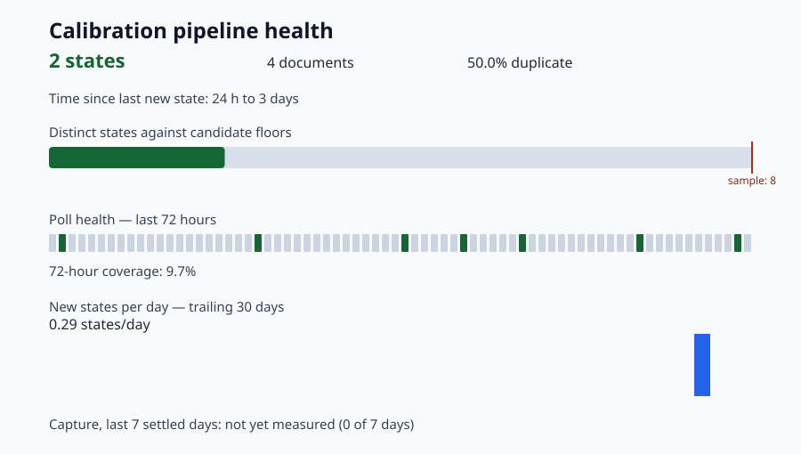
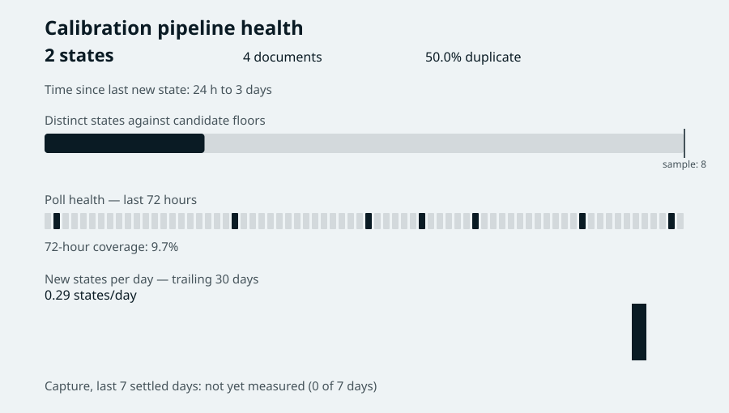
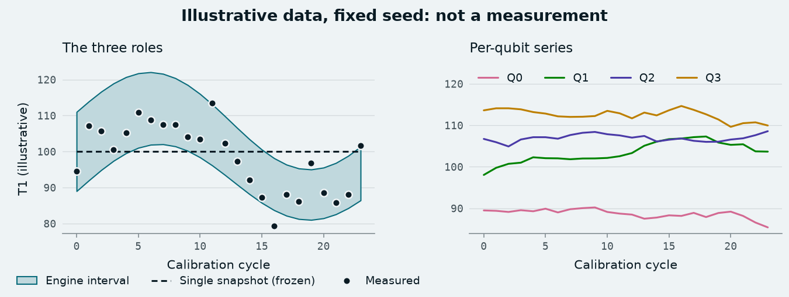
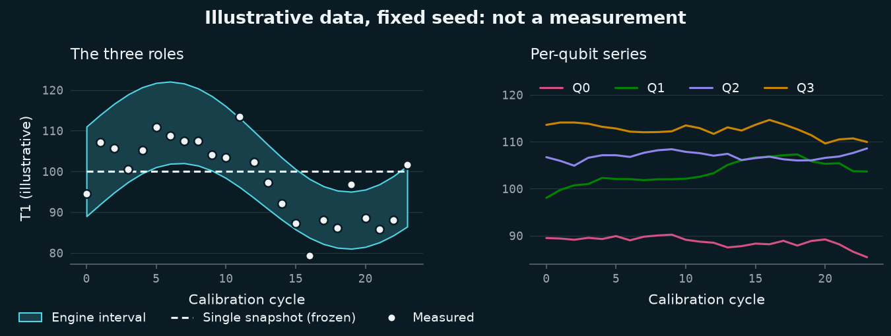

# 2026-10-16: brand-chart-style

## Problem / Motivation

On 2026-10-16 the SuperconducTED brand was finalised: the technical-cutaway mark, the Cryostat
palette and the tagline "Noise as a range, not a number." It ships a validated matplotlib chart
style (`SuperconducTED/.github`, branch `brand/superconducted-identity`, folder
`brand/figures/`, commit `06f1959`) whose one colour rule is that the accent marks a range
(the engine's interval) and nothing else. The engine had no chart style at all, so every
figure the team draws would pick its own colours, and Phase 3 is about to produce the first
figures that show the engine's answer as an interval.

Before anything was changed, the engine was surveyed for what draws charts today:

| Producer | Where | Regenerable | Touched here |
| --- | --- | --- | --- |
| `scripts/pipeline_health.py::render_svg`, publishing `health/progress.svg` on `calibration-data` | `main` | Yes, deterministic, golden-tested | **Yes, recoloured** |
| `generate.py::burnup_svg` and `index.html` | orphan branch `phase-3-dashboard` | Yes, daily scheduled refresh | No (not on `main`; see Follow-ups) |
| `analysis/report/template.html` (d3) and `build_page.py`, the two Turkish advisor report pages | PR #111's branch only | Yes, from JSON | No (dated records of published versions, unmerged) |
| Three inline SVG diagrams in `docs/advisor/2026-09-09-akba-brief/01..03` | `main` | No, hand-written | No (dated record of a sent brief) |
| 66 PNGs under `docs/evidence/` | `main` | No | No: they are terminal screenshots of verification runs, not charts |

No branch of the engine imported matplotlib or plotly (`git grep` over every `origin` branch
except the two `calibration-data` branches, which hold data only). Mert decided on 2026-10-16
to do both of the options this survey put to him: vendor the kit now, because a matplotlib
figure is coming this phase (A), and recolour the one chart on `main` (B). No GitHub issue
covers figures or the brand, so this change has no linked issue.

## What changed

| File | One-sentence description |
| --- | --- |
| `src/superconducted/figures/__init__.py` | The brand's chart helper (`use`, `band`, `crisp`, `measured`, `series`, `band_handle`, `mono_ticks`), typed for `mypy --strict`, Cryostat only. |
| `src/superconducted/figures/roles.json` | Every named chart colour per palette and mode, a byte-identical copy of the brand's file at `06f1959`. |
| `src/superconducted/figures/styles/superconducted.mplstyle` | The Cryostat light-ground matplotlib style, byte-identical to the brand's. |
| `src/superconducted/figures/styles/superconducted-dark.mplstyle` | The Cryostat dark-ground style, byte-identical to the brand's. |
| `pyproject.toml` | New optional extra `figures = ["matplotlib>=3.8,<4"]`; the same requirement added to `dev`. |
| `requirements-dev.txt` | Pins `matplotlib==3.11.2`, the version the brand's style checks ran on. |
| `tests/test_figures.py` | 49 tests: the vendored bytes, the style loading silently, every role's look and guard, `mono_ticks`, and a silent font fallback. |
| `scripts/pipeline_health.py` | `render_svg` draws in the Cryostat roles, read from the vendored `roles.json` as JSON (`ROLES_FILE`, `chart_colours`, `COLOURS`). |
| `tests/test_pipeline_health.py` | Two colour pins follow the new roles; new `TestBrandColours` (4 tests) pins the mapping, bans the accent and gates contrast. |
| `tests/fixtures/pipeline_health/expected/progress.svg` | The golden artifact, regenerated; colours only. |
| `docs/implementations/2026-10-16-brand-chart-style/` | Before and after SVGs, the example figure (light and dark), and the script that renders it. |
| `docs/numerical-claims.md` | NC-021 (test-suite size) re-measured, in a separate docs-only commit that names the commit it measured. |

## Implementation approach

### A. The kit, vendored as `superconducted.figures`

The three data files are copied byte for byte from the brand commit (`git show
06f1959:brand/figures/<path>`), and `tests/test_figures.py::TestVendoredFiles` pins each one's
sha256, so a hand edit fails CI. The brand's own rule is that `styles/` and `roles.json` are
generated, never edited; a change belongs in the brand repository and is re-vendored here.

The helper is the brand's `superconducted_figures.py` with four differences, listed in its
module docstring and nowhere else:

1. Type annotations, so it passes `mypy --strict` (its home is `src/superconducted`, which is
   in mypy's `files`). `band` returns the `PolyCollection` that `fill_between` makes;
   `crisp` and `measured` return a `Line2D`; `mono_ticks` returns its argument's own type.
2. Only the chosen palette ships. `PALETTES` is `("cryostat",)`; the two styles keep the
   brand's generic names `superconducted.mplstyle` and `superconducted-dark.mplstyle`, which
   the brand's build copies byte for byte from the Cryostat files. Asking for one of the five
   other brand options raises `ValueError` and applies nothing.
3. `mono_ticks` tells a `Figure`, an `Axes` and an iterable of `Axes` apart with
   `isinstance`, where the brand checks `hasattr(target, "tick_params")`.
4. Error messages name `superconducted.figures`.

Contract (unchanged from the brand): `use(palette=None, dark=False)` applies the style
globally (`plt.style.use`) and selects the roles; `band`, `crisp`, `measured`, `series` and
`band_handle` raise `RuntimeError` before it. Each drawing helper returns its artist, forwards
extra keyword arguments to matplotlib, and raises `TypeError` on a colour keyword (`color`,
`c`, `facecolor`, `edgecolor`, `fc`, `ec`, `markerfacecolor`, `mfc`), because the colour is the
role. `series(n)` raises `ValueError` past the six-colour sequence instead of cycling.

Usage:

```python
import matplotlib.pyplot as plt
from superconducted import figures as scf

scf.use()                                   # Cryostat, light ground; dark=True for dark
fig, ax = plt.subplots()
scf.band(ax, cycles, lower, upper, label="Engine interval")
scf.crisp(ax, cycles, snapshot_value, label="Single snapshot (frozen)")
scf.measured(ax, cycles, values, label="Measured")
ax.legend()
scf.mono_ticks(fig)
fig.savefig("figure.png")
```

The brand's README (`brand/figures/README.md` at `06f1959`) holds the rules a figure author
needs: what each role means, the do and don't list, the fonts and how to install them.

### B. The pipeline-health SVG in the Cryostat roles

`render_svg` keeps every element, coordinate, text node and font size; only colours change.
They come from `roles.json` through `chart_colours()`, which reads the file as JSON: the
`calibration-health` render job runs the script with a bare interpreter
(`PYTHONPATH=source`, nothing installed), so importing `superconducted.figures` there would
fail on matplotlib. `ROLES_FILE` is resolved from the script's own path, which the full source
checkout in that job provides; a missing file fails the render loudly.

The dashboard shows no interval, so it uses no accent. Each part takes the role whose meaning
fits it (the brand defines no status colours, so "fired" and "progress" are drawn as data, in
ink):

| SVG part | Before | After (role) |
| --- | --- | --- |
| Background | `#f8fafc` | `#EEF3F5` (`ground`) |
| Title, state count, metrics | `#0f172a`, `#166534`, `#1e293b` | `#0A1B24` (`text`) |
| Labels | `#334155` | `#45535A` (`text_secondary`) |
| Floor ticks and their labels | `#9a3412`, `#7c2d12` | `#45535A` (`text_secondary`) |
| Progress bar, fired poll hours, daily bars | `#166534`, `#2563eb` | `#0A1B24` (`ink`) |
| Progress track, unfired poll hours | `#d7e0ea`, `#cbd5e1` | `#D3D9DC` (`grid`) |

The text keeps the generic `sans-serif` face. `FONT_PX` and `ADVANCE_RATIO` model
`sans-serif` advances for the canvas-bounds check, and naming the brand face would change
glyph widths for any viewer who has it installed.

Before (`main` at `fec055c`) and after, both rendered from the committed end-to-end fixture:





### The example figure

There was no matplotlib figure to restyle, so there is no "before" for A. The example shows
the three roles and a per-qubit panel on **illustrative data from a fixed seed**, labelled as
such on the figure; no number on it is a measurement, so it needs no row in
`docs/numerical-claims.md`.





## Mathematical / Statistical details

**Contrast** is the WCAG 2.x ratio the brand gates on (`brand/tools/wcag.py`), reimplemented in
`tests/test_pipeline_health.py::_contrast`. For an sRGB channel value `c` in `[0, 1]`, the
linear value is `c / 12.92` when `c <= 0.04045`, else `((c + 0.055) / 1.055)^2.4`; relative
luminance is `L = 0.2126 R + 0.7152 G + 0.0722 B` over the linear channels; and the ratio of
two colours is `(L_hi + 0.05) / (L_lo + 0.05)`, from 1 (identical) to 21 (black on white).
`test_contrast_is_the_published_wcag_ratio` pins both ends.

The gates, the brand's: text at least 4.5:1 on the ground, every data mark at least 3:1. The
track and unfired hours are the brand's `grid` role, decoration that the brand reports and
does not gate. Measured on the ground `#EEF3F5`:

| Role | Colour | Contrast | Gate |
| --- | --- | --- | --- |
| `text` | `#0A1B24` | 15.71 | 4.5 |
| `text_secondary` | `#45535A` | 7.12 | 4.5 (text) and 3 (ticks) |
| `ink` | `#0A1B24` | 15.71 | 3 |
| `grid` | `#D3D9DC` | 1.27 | none (decoration) |

Every text and mark colour of the old SVG also cleared these floors (the lowest, the daily
bars' `#2563eb`, at 4.94); its track and unfired hours sat at 1.28 and 1.42. The change is in
meaning, not in legibility: green and blue no longer read as status or as a series.

**The band tint**, which the helper draws and this change does not alter, is a solid colour,
not an alpha: per sRGB channel `t = (1 - a) * ground + a * accent`, rounded to 8 bits, with
`a = 0.20` measured by the brand between a colour-vision floor (0.19 light) and a contrast
ceiling (0.23 light). The derivation is in the brand README, section "The band tint rule".

## Design decisions

- **A copy over a dependency on the brand repository.** A git submodule or a pip install
  from the `.github` repository would make the engine's CI depend on a branch that is not
  `main` there and has no pull request. A copy pinned by hash keeps CI self-contained and
  makes drift a visible test failure.
- **Inside the package, not under `scripts/` or `docs/`.** Team figures will be drawn from
  notebooks, scripts and future report builders alike; `from superconducted import figures`
  works from all of them, and the wheel ships the data files (checked: `pip wheel .` carries
  `roles.json` and both styles).
- **Typed copy over a mypy exclusion.** Excluding the module would leave the one file
  team figure code imports unchecked. The cost is that the copy is no longer byte-identical
  to the brand's helper; the four differences are listed in its docstring, and annotating the
  brand's copy would make the two converge (see Follow-ups).
- **Cryostat only.** The other five palettes are the record of a decision already taken;
  shipping them would invite their use.
- **matplotlib as an optional extra, also in `dev`.** The engine itself draws nothing, so
  runtime users do not pay for matplotlib. Listing it in `dev` too (and pinning it in
  `requirements-dev.txt`, which CI installs) means `tests/test_figures.py` imports it
  unconditionally: a missing matplotlib is a loud failure, not 49 silently skipped tests.
- **B reads `roles.json`, it does not hard-code the hex values.** One source: when the
  brand's palette is re-vendored, the dashboard follows. `TestBrandColours` pins the mapping
  from roles to SVG parts, so a re-vendor that moves a colour is a visible golden diff.
- **No accent and no status colours on the dashboard.** The brand defines none for status
  and forbids the accent outside a range; inventing a "good" green would be a new brand
  colour decided inside an engine pull request.
- **Light ground only for the SVG.** It is embedded as an image in the `calibration-data`
  README, where it cannot follow the viewer's theme.

## Verification

All on the pinned stack (Python 3.12.10, a fresh venv from `requirements.txt` and
`requirements-dev.txt`, then `pip install -e . --no-deps`, the CI recipe):

- `python -m pytest tests/test_figures.py tests/test_pipeline_health.py -q`: 109 passed.
- `python -m pytest tests/ -q`: see NC-021 for the size and the commit it was run at.
- `ruff check .`, `ruff format --check .`, `mypy --strict`: clean.
- **Only colours changed in the SVG.** An element-by-element comparison of the old and new
  golden `progress.svg` (same 120 elements in the same order, every non-colour attribute
  equal, all 12 text nodes equal, the style block equal once its colours are masked) found
  colour differences only; a self-test that changed one text node (`2 states` to `3 states`)
  was reported. `metrics.json`, the source of every number in the SVG, is byte-identical.
- **The new guards can fail.** Each was broken on purpose and went red: one byte of
  `roles.json`; a solid crisp line; `mono_ticks` setting `sans-serif`; dropping `ec` from the
  colour-override guard; disabling the band's bound check; ringing measured points in ink;
  painting the SVG's track in the accent; a label colour below 4.5:1; and rendering a fired
  hour in the old blue.
- **Nothing outside `superconducted.figures` needs matplotlib.** In a second venv built the
  way the `calibration-health` poll job builds it (`requirements.txt` only, then
  `pip install -e . --no-deps`), matplotlib is absent; `import superconducted` and
  `import superconducted.calibration.poller` load without it, `superconducted-poll --help`
  runs, and `import superconducted.figures` fails with a plain `ModuleNotFoundError` naming
  matplotlib. With the bare 3.12 interpreter and `PYTHONPATH` set to the checkout, as the
  render job runs it, `backfill_state_index.py` then `pipeline_health.py` over a copy of the
  end-to-end fixture write a `progress.svg` and `metrics.json` byte-identical to the golden
  ones. (Run the copy under a short path: below a Windows path near 260 characters the
  backfill cannot open the snapshot files and indexes nothing.)
- **The font fallback is silent.** With the style applied and the brand fonts absent (this
  machine), a full figure renders with no `matplotlib` warning; forcing a missing font
  produces `findfont` warnings, which the test would catch.
- Rerun the example: `python docs/implementations/2026-10-16-brand-chart-style/render_example.py`.

**Side effect after merge.** The next scheduled `calibration-health` render commits one
changed `health/progress.svg` to `calibration-data` (colours only); the commit-on-change guard
treats it like any other byte change.

## Follow-ups

- `phase-3-dashboard` (orphan branch): its burn-up line is drawn in `--accent:#00707f`,
  which the brand's colour rule reserves for a range. Its generator and CSS tokens should
  take the Cryostat roles; that lands on that branch, not through a pull request to `main`.
- Annotate the brand's own `superconducted_figures.py` the same way, so the engine's copy
  becomes byte-identical too and the sync test can pin all four files.
- When the first Phase 3 figure is drawn (the interval report of #64 is the natural first
  user of `band`), it should use `superconducted.figures`; any number it shows needs its row
  in `docs/numerical-claims.md`.

## Related docs

- Brand kit: `SuperconducTED/.github`, branch `brand/superconducted-identity`, commit
  `06f1959`, `brand/figures/README.md` (roles, rules, fonts, validation).
- `docs/implementations/2026-09-05-pipeline-health-dashboard.md` (the dashboard's contract:
  NFR-3 determinism, the golden fixture, commit-on-change).
- ADR-004 in `docs/decisions.md` (pinned requirements files, loose ranges in
  `pyproject.toml`).
- `docs/numerical-claims.md`, Rule 6 and NC-021.
